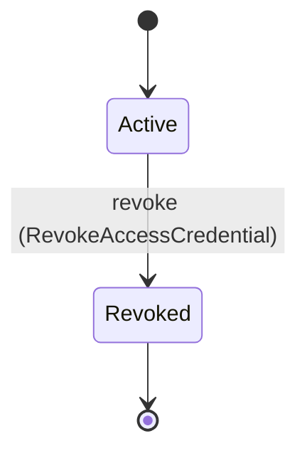
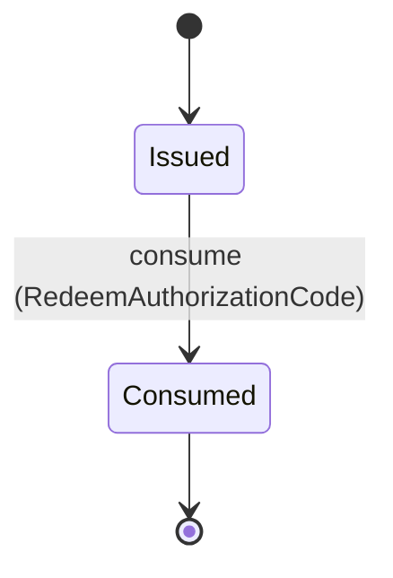
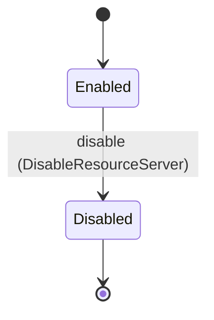
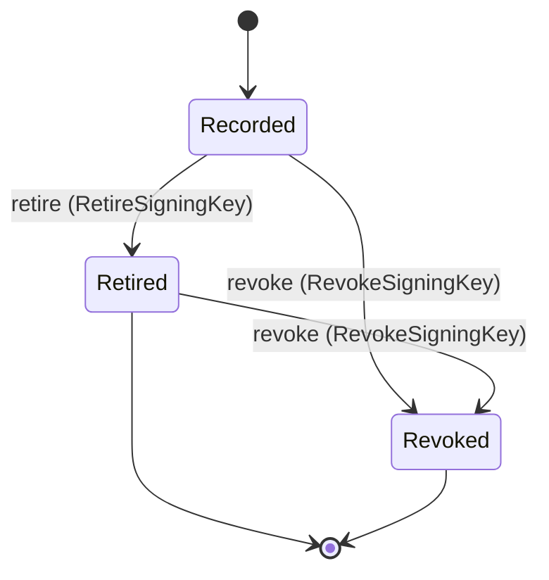

<!--
generated from mandate v1
model digest 45424649386e88d7cfddb9c793b84e2647816f795d4b7536c63741af3c136a4e
contract digest slice-sha256/2:3e506166d75e7210a6e49c4cf38a3d2f0aa6d777bbc5bdc7d211b4fd080a392a
do not edit: regenerate with `ess generate`
-->

# credential

`mandate.credential` is one of mandate's bounded contexts. [Back to the index](../index.md).

## Types

### `IdentityScope`

`mandate.credential.IdentityScope` is one of `OpenId`, `Email`, `Profile`, `Groups` and `OfflineAccess`.

### `IdentityTokenId`

`mandate.credential.IdentityTokenId` wraps `Uuid` and is not interchangeable with one: the whole value of naming it separately is the crossings the model then refuses.

### `SubjectTokenType`

`mandate.credential.SubjectTokenType` is one of `AccessToken` and `IdToken`.

## Entities

An entity is what this context is about: something with an identity that outlives any one request, a shape, and a lifecycle. The lifecycle is exhaustive — a move that is not drawn below is a move this specification does not permit, and that is the only way it says so. Every move is labelled with the command that takes it, because a move nothing can trigger is refused rather than drawn.

### `AccessCredential`

`mandate.credential.AccessCredential`.

An instance is identified by `id`, a `mandate.core.CredentialId`. The name is part of the model and not a convention: a view projects the identity under that name, so a projection inventing its own would disagree with the view.

It holds:

- `descriptor` — `mandate.core.CredentialDescriptor`
- `reference_verifier` — `Optional<mandate.core.CredentialVerifier>`, which may be absent
- `epochs` — `Optional<mandate.core.EpochSnapshotRef>`, which may be absent
- `issued_at` — `Timestamp`

It references at most one [`mandate.identity.SecurityEpochSnapshot`](mandate-identity.md#securityepochsnapshot), as `epoch_snapshot_record`, carried by `AccessCredential.epochs`.

No invariant is declared, so nothing here constrains an instance at rest.

Its state is a `mandate.credential.AccessCredential.State`, one of `Active` and `Revoked`. That enum is synthesised from the lifecycle rather than declared beside it, so the states a view's filter compares and the states drawn below cannot disagree.

An instance is created in `Active`. `Revoked` is terminal, so an instance may rest there forever. That is declared rather than inferred from having no way out: an entity that cannot leave a state is either finished or stuck, and only its author knows which.

Each move is taken by a declared command outcome, and a move nothing takes is refused as `missing_causation` rather than left as a state change nobody can trigger:

- `revoke` — taken by `mandate.credential.RevokeAccessCredential` on its `accepted` outcome

An instance is brought into existence by `mandate.credential.ExchangeCredential` on its `accepted` outcome, `mandate.credential.IssueReferenceCredential` on its `accepted` outcome and `mandate.credential.IssueSelfContainedCredential` on its `accepted` outcome.

Illegal transitions are illegal by absence: no rule forbids them, there is simply no arrow, because a rule would be a second place for the same truth to live. A diagram cannot show an absence, so the pairs it does not connect are listed here, derived from the same transitions — anything named below is a move this specification does not permit.

- `Revoked` may not become `Active`

No view projects it, so nothing outside this context is promised a way to observe one.

### `AuthorizationCode`

`mandate.credential.AuthorizationCode`.

An instance is identified by `id`, a `mandate.core.AuthorizationCodeId`. The name is part of the model and not a convention: a view projects the identity under that name, so a projection inventing its own would disagree with the view.

It holds:

- `client_id` — `mandate.core.OAuthClientId`
- `session_id` — `mandate.core.SessionId`
- `verifier` — `mandate.core.CredentialVerifier`
- `challenge` — `mandate.core.PkceChallenge`
- `method` — `mandate.core.PkceMethod`
- `redirect_uri` — `mandate.core.RedirectUri`
- `expires_at` — `Timestamp`
- `target` — `mandate.core.ResourceServerId`
- `scope` — `mandate.core.AuthorityScope`
- `identity_scopes` — `Optional<List<mandate.credential.IdentityScope>>`, which may be absent

It references at most one [`mandate.federation.OAuthClient`](mandate-federation.md#oauthclient), as `client_id_record`, carried by `AuthorizationCode.client_id`. It references at most one [`mandate.identity.Session`](mandate-identity.md#session), as `session_id_record`, carried by `AuthorizationCode.session_id`. It references at most one [`ResourceServer`](#resourceserver), as `target_record`, carried by `AuthorizationCode.target`.

No invariant is declared, so nothing here constrains an instance at rest.

Its state is a `mandate.credential.AuthorizationCode.State`, one of `Consumed` and `Issued`. That enum is synthesised from the lifecycle rather than declared beside it, so the states a view's filter compares and the states drawn below cannot disagree.

An instance is created in `Issued`. `Consumed` is terminal, so an instance may rest there forever. That is declared rather than inferred from having no way out: an entity that cannot leave a state is either finished or stuck, and only its author knows which.

Each move is taken by a declared command outcome, and a move nothing takes is refused as `missing_causation` rather than left as a state change nobody can trigger:

- `consume` — taken by `mandate.credential.RedeemAuthorizationCode` on its `accepted-with-identity-token` outcome and `mandate.credential.RedeemAuthorizationCode` on its `accepted` outcome

An instance is brought into existence by `mandate.credential.IssueAuthorizationCode` on its `accepted` outcome.

Illegal transitions are illegal by absence: no rule forbids them, there is simply no arrow, because a rule would be a second place for the same truth to live. A diagram cannot show an absence, so the pairs it does not connect are listed here, derived from the same transitions — anything named below is a move this specification does not permit.

- `Consumed` may not become `Issued`

No view projects it, so nothing outside this context is promised a way to observe one.

### `ResourceServer`

`mandate.credential.ResourceServer`.

An instance is identified by `id`, a `mandate.core.ResourceServerId`. The name is part of the model and not a convention: a view projects the identity under that name, so a projection inventing its own would disagree with the view.

It holds:

- `organization_id` — `mandate.core.OrganizationId`
- `audience` — `mandate.core.Audience`
- `credential_profile` — `mandate.core.CredentialProfile`
- `allowed_exchange_sources` — `List<mandate.core.ResourceServerId>`
- `client_id` — `Optional<mandate.core.OAuthClientId>`, which may be absent

It references at most one [`mandate.tenancy.Organization`](mandate-tenancy.md#organization), as `organization_id_record`, carried by `ResourceServer.organization_id`. It references any number of [`ResourceServer`](#resourceserver), as `allowed_exchange_source_records`, carried by `ResourceServer.allowed_exchange_sources`. It references at most one [`mandate.federation.OAuthClient`](mandate-federation.md#oauthclient), as `client_id_record`, carried by `ResourceServer.client_id`.

No invariant is declared, so nothing here constrains an instance at rest.

Its state is a `mandate.credential.ResourceServer.State`, one of `Disabled` and `Enabled`. That enum is synthesised from the lifecycle rather than declared beside it, so the states a view's filter compares and the states drawn below cannot disagree.

An instance is created in `Enabled`. `Disabled` is terminal, so an instance may rest there forever. That is declared rather than inferred from having no way out: an entity that cannot leave a state is either finished or stuck, and only its author knows which.

Each move is taken by a declared command outcome, and a move nothing takes is refused as `missing_causation` rather than left as a state change nobody can trigger:

- `disable` — taken by `mandate.credential.DisableResourceServer` on its `accepted` outcome

An instance is brought into existence by `mandate.credential.RegisterResourceServer` on its `accepted` outcome.

Illegal transitions are illegal by absence: no rule forbids them, there is simply no arrow, because a rule would be a second place for the same truth to live. A diagram cannot show an absence, so the pairs it does not connect are listed here, derived from the same transitions — anything named below is a move this specification does not permit.

- `Disabled` may not become `Enabled`

No view projects it, so nothing outside this context is promised a way to observe one.

### `SigningKey`

`mandate.credential.SigningKey`.

An instance is identified by `id`, a `mandate.core.SigningKeyId`. The name is part of the model and not a convention: a view projects the identity under that name, so a projection inventing its own would disagree with the view.

It holds:

- `key_reference` — `mandate.core.KeyReference`
- `thumbprint` — `String`
- `algorithm` — `mandate.core.SigningAlgorithm`
- `window` — `mandate.core.SigningKeyWindow`

It declares no relation to another entity, and no other entity names it.

Every instance satisfies `window.not_before < window.expires_at` — a predicate over this entity's own fields, checked against them rather than stored as a sentence, so an invariant reading something the entity does not have is refused instead of documented.

Its state is a `mandate.credential.SigningKey.State`, one of `Recorded`, `Retired` and `Revoked`. That enum is synthesised from the lifecycle rather than declared beside it, so the states a view's filter compares and the states drawn below cannot disagree.

An instance is created in `Recorded`. `Retired` and `Revoked` are terminal, so an instance may rest there forever. That is declared rather than inferred from having no way out: an entity that cannot leave a state is either finished or stuck, and only its author knows which.

Each move is taken by a declared command outcome, and a move nothing takes is refused as `missing_causation` rather than left as a state change nobody can trigger:

- `retire` — taken by `mandate.credential.RetireSigningKey` on its `accepted` outcome
- `revoke` — taken by `mandate.credential.RevokeSigningKey` on its `accepted` outcome

An instance is brought into existence by `mandate.credential.RegisterSigningKey` on its `accepted` outcome.

Illegal transitions are illegal by absence: no rule forbids them, there is simply no arrow, because a rule would be a second place for the same truth to live. A diagram cannot show an absence, so the pairs it does not connect are listed here, derived from the same transitions — anything named below is a move this specification does not permit.

- `Retired` may not become `Recorded`
- `Revoked` may not become `Recorded`
- `Revoked` may not become `Retired`

No view projects it, so nothing outside this context is promised a way to observe one.

## Commands

### `DisableResourceServer`

`mandate.credential.DisableResourceServer`.

It takes:

- `id` — `mandate.core.ResourceServerId`
- `context` — `mandate.core.VerifiedContext`

It has three outcomes.

**`accepted`** — The default branch, taken when no other outcome's condition matched. It moves a `mandate.credential.ResourceServer` from `Enabled` to `Disabled`, along the declared move `disable`. The instance is the one named by the input field `id`. It emits `mandate.credential.ResourceServerDisabled`. A test reaches it by constructing an input that satisfies no other outcome's condition.

**`wrong-state`** — Taken when the subject is resting in a state none of this command's moves start from — a `mandate.credential.ResourceServer` in `Disabled`, which is what is left of the lifecycle once this command's own moves are taken away. The document lists none of it. No entity in this specification changes. It reports `mandate.credential.Denied`, carrying `reason`. It emits nothing. A test reaches it by driving an instance into one of those states and then issuing the command, because no input selects this branch.

**`denied`** — Decided outside the input: Caller lacks resource-server administration authority, server is outside the verified organization, or durable disablement cannot prevent subsequent issuance.. No predicate over the input reaches this branch, and saying `when: false` instead would have claimed it is unreachable, which is a different and false statement. No entity in this specification changes. It reports `mandate.credential.Denied`, carrying `reason`. It emits nothing. A test reaches it by injecting the declared fault, because no input can.

### `ExchangeCredential`

`mandate.credential.ExchangeCredential`.

It takes:

- `subject_proof` — `mandate.core.CredentialProof`
- `actor_proof` — `Optional<mandate.core.CredentialProof>`, which may be absent
- `target` — `mandate.core.ResourceServerId`
- `requested_scope` — `mandate.core.AuthorityScope`
- `delegation_id` — `Optional<mandate.core.DelegationId>`, which may be absent
- `subject_token_type` — `Optional<mandate.credential.SubjectTokenType>`, which may be absent

It has two outcomes.

**`accepted`** — An access-credential subject is admitted when its source registration is among the target's allowed_exchange_sources. An identity-token subject (subject_token_type IdToken) is an identity token this deployment signed, unexpired, under a key still admitted for verification; its source is the client it was issued to (its azp, else its one audience). It is admitted only to a target registered with a client, and only when that client lists the source client among its trusted_peers and the source client, the target's client and the target are of one organization (fork F20). Both forms are decided by this one admission and recorded by this one event; a trusted peer is never a second authority path, and a peer relation is never transitive. The default branch, taken when no other outcome's condition matched. It creates a `mandate.credential.AccessCredential`, which starts in `Active`. The new instance's identity is published as `credential_id` on `mandate.credential.TokenExchangeAllowed`. It emits `mandate.credential.TokenExchangeAllowed`. A test reaches it by constructing an input that satisfies no other outcome's condition.

**`denied`** — Decided outside the input: Either independently validated proof is invalid/revoked/expired/stale; actor, tenant, registered target/source, scope, space, delegation or ceiling binding fails; two current capability ceilings share one agent and organization-or-platform key; transitive delegation is requested; approval is required; an identity-token subject's client is not a trusted peer of the target's client, the target names no client, or the two clients are of different organizations; or authority/expiry narrowing and durable audit fail.. No predicate over the input reaches this branch, and saying `when: false` instead would have claimed it is unreachable, which is a different and false statement. No entity in this specification changes. It reports `mandate.credential.Denied`, carrying `reason`. It emits nothing. A test reaches it by injecting the declared fault, because no input can.

### `IntrospectCredential`

`mandate.credential.IntrospectCredential`.

It takes:

- `caller_proof` — `mandate.core.CredentialProof`
- `credential_proof` — `mandate.core.CredentialProof`

It has two outcomes.

**`accepted`** — An active answer carries the descriptor and the credential_id of the record this log holds. An inactive answer carries neither — that is the answer for a credential this deployment revoked, one whose expiry has passed, and a well-formed proof that resolves to no record at all, which are one answer here and not three. The three are distinguished by nothing this event carries, deliberately, because a caller holding a well-formed proof learns only whether it is usable. This outcome creates, moves and updates nothing, and CredentialIntrospected folds into no record — its credential_id names an instance only when one exists in this log, and a fold reading it must not take the name for the existence of a record some other event created. The presented credential may have been issued by a deployment this log never saw, which is why the field is optional rather than the event's subject. The default branch, taken when no other outcome's condition matched. No entity in this specification changes. It emits `mandate.credential.CredentialIntrospected`. A test reaches it by constructing an input that satisfies no other outcome's condition.

**`denied`** — Decided outside the input: Caller proof lacks introspection authority for the registered server/tenant or is itself invalid, revoked or expired, the presented credential proof is malformed, principal/connection/epoch validation fails, audience mismatches, or authoritative online resolution is unavailable.. No predicate over the input reaches this branch, and saying `when: false` instead would have claimed it is unreachable, which is a different and false statement. No entity in this specification changes. It reports `mandate.credential.Denied`, carrying `reason`. It emits nothing. A test reaches it by injecting the declared fault, because no input can.

### `IssueAuthorizationCode`

`mandate.credential.IssueAuthorizationCode`.

It takes:

- `context` — `mandate.core.VerifiedContext`
- `client_id` — `mandate.core.OAuthClientId`
- `session_id` — `mandate.core.SessionId`
- `target` — `mandate.core.ResourceServerId`
- `requested_scope` — `mandate.core.AuthorityScope`
- `challenge` — `mandate.core.PkceChallenge`
- `method` — `mandate.core.PkceMethod`
- `redirect_uri` — `mandate.core.RedirectUri`
- `expires_at` — `Timestamp`
- `identity_scopes` — `Optional<List<mandate.credential.IdentityScope>>`, which may be absent

It has two outcomes.

**`accepted`** — STS stores only a non-reversible verifier bound to the validated client, session, exact redirect, S256 challenge, registered target, narrowed scope, bounded expiry and the OpenID Connect scopes the authorization granted. The authorization request's nonce is held in memory beside the code for the code's lifetime and is no field of the record or the event (RedeemAuthorizationCode). Only the transient code is returned to the public-client adapter. The default branch, taken when no other outcome's condition matched. It creates a `mandate.credential.AuthorizationCode`, which starts in `Issued`. The new instance's identity is published as `code_id` on `mandate.credential.AuthorizationCodeIssued`. It emits `mandate.credential.AuthorizationCodeIssued`. A test reaches it by constructing an input that satisfies no other outcome's condition.

**`denied`** — Decided outside the input: Trusted control-plane caller/session context, registered client, exact redirect URI, S256 policy, tenant/target agreement, authority narrowing or bounded expiry validation fails, or the client the code would be bound to is disabled.. No predicate over the input reaches this branch, and saying `when: false` instead would have claimed it is unreachable, which is a different and false statement. No entity in this specification changes. It reports `mandate.credential.Denied`, carrying `reason`. It emits nothing. A test reaches it by injecting the declared fault, because no input can.

### `IssueReferenceCredential`

`mandate.credential.IssueReferenceCredential`.

It takes:

- `context` — `mandate.core.VerifiedContext`
- `target` — `mandate.core.ResourceServerId`
- `requested_scope` — `mandate.core.AuthorityScope`

It has two outcomes.

**`accepted`** — The default branch, taken when no other outcome's condition matched. It creates a `mandate.credential.AccessCredential`, which starts in `Active`. The new instance's identity is published as `credential_id` on `mandate.credential.CredentialReferenceIssued`. It emits `mandate.credential.CredentialReferenceIssued`. A test reaches it by constructing an input that satisfies no other outcome's condition.

**`denied`** — Decided outside the input: Validated context is expired/revoked/stale, subject/actor authority or ceilings do not cover requested scope, target/profile is unregistered/disabled/outside tenant, expiry cannot be bounded, or verifier-only persistence and required audit cannot commit.. No predicate over the input reaches this branch, and saying `when: false` instead would have claimed it is unreachable, which is a different and false statement. No entity in this specification changes. It reports `mandate.credential.Denied`, carrying `reason`. It emits nothing. A test reaches it by injecting the declared fault, because no input can.

### `IssueSelfContainedCredential`

`mandate.credential.IssueSelfContainedCredential`.

It takes:

- `context` — `mandate.core.VerifiedContext`
- `target` — `mandate.core.ResourceServerId`
- `requested_scope` — `mandate.core.AuthorityScope`

It has two outcomes.

**`accepted`** — The default branch, taken when no other outcome's condition matched. It creates a `mandate.credential.AccessCredential`, which starts in `Active`. The new instance's identity is published as `credential_id` on `mandate.credential.CredentialSelfContainedIssued`. It emits `mandate.credential.CredentialSelfContainedIssued`. A test reaches it by constructing an input that satisfies no other outcome's condition.

**`denied`** — Decided outside the input: Validated context is expired/revoked/stale, subject/actor authority or ceilings do not cover requested scope, target/profile/signing algorithm or key is unadmitted, expiry cannot be bounded, or the promised revocation/audit guarantee cannot be met.. No predicate over the input reaches this branch, and saying `when: false` instead would have claimed it is unreachable, which is a different and false statement. No entity in this specification changes. It reports `mandate.credential.Denied`, carrying `reason`. It emits nothing. A test reaches it by injecting the declared fault, because no input can.

### `RedeemAuthorizationCode`

`mandate.credential.RedeemAuthorizationCode`.

It takes:

- `code_id` — `mandate.core.AuthorizationCodeId`
- `client_id` — `mandate.core.OAuthClientId`
- `code` — `mandate.core.CredentialProof`
- `pkce_verifier` — `mandate.core.CredentialProof`
- `redirect_uri` — `mandate.core.RedirectUri`
- `client_secret` — `Optional<mandate.core.CredentialProof>`, which may be absent

It has four outcomes.

**`accepted-with-identity-token`** — A code whose authorization granted openid redeems exactly as the accepted outcome below does, and in the same transaction the STS signs one identity token and records mandate.credential.IdentityTokenIssued. The token's issuer is the deployment's, its audience the client, its subject the session's principal (fork F1), its nonce the authorization request's, its auth_time the instant the session's login authenticated and its lifetime the deployment's identity-token lifetime; it is signed under a signing key admitted for issuance now, and the event names that key. The event carries the token's identifier, the code, the client, the principal, the session, the signing key and the two instants, and no claim value — no email, name, groups or nonce enters this log (fork F13). The nonce is held in memory beside the code for the code's lifetime, as the pending sign-in is, and no record or event of this contract carries it; a code outstanding when the STS restarts has no held authorization request and is refused at redemption, and the application starts the sign-in again. A transaction that cannot sign issues neither the token nor the access credential and consumes nothing. Taken when the existing subject's stored fields satisfy `exists granted in identity_scopes: (granted == OpenId)`. It moves a `mandate.credential.AuthorizationCode` from `Issued` to `Consumed`, along the declared move `consume`. The instance is the one named by the input field `code_id`. It emits `mandate.credential.AuthorizationCodeRedeemed` and `mandate.credential.IdentityTokenIssued`. A test establishes and independently observes the subject enum fact before selecting this branch.

**`accepted`** — STS atomically consumes the code and persists the narrowed credential and audit outbox. The returned credential remains bound to the code target, scope, session and expiry; a failed or replayed transaction produces no credential. The command takes no context input and admits no caller-supplied selector — the generated context on the emitted event takes its subject, organization and audience from the code record and the session it names through the STS's session port, its credential as the credential_id this outcome issues, its correlation as the one the outcome mints for this request, and its actor, delegation and execution as absent unless the code record names them. The audience is the one published by the registration the code record's target names. The epoch whose staleness the denial names is the session's own, resolved through that same port, because a redemption presents no source credential of its own. The credential this outcome issues is recorded by mandate.credential.AuthorizationCodeRedeemed, which carries the whole mandate.credential.AccessCredential record, and the epoch snapshot it binds is the one this command answers in its response; the outcome's one subject stays the code it consumes, so the seeding is declared in this domain's header. The default branch, taken when no other outcome's condition matched. It moves a `mandate.credential.AuthorizationCode` from `Issued` to `Consumed`, along the declared move `consume`. The instance is the one named by the input field `code_id`. It emits `mandate.credential.AuthorizationCodeRedeemed`. A test reaches it by constructing an input that satisfies no other outcome's condition.

**`wrong-state`** — Taken when the subject is resting in a state none of this command's moves start from — a `mandate.credential.AuthorizationCode` in `Consumed`, which is what is left of the lifecycle once this command's own moves are taken away. The document lists none of it. No entity in this specification changes. It reports `mandate.credential.Denied`, carrying `reason`. It emits nothing. A test reaches it by driving an instance into one of those states and then issuing the command, because no input selects this branch.

**`denied`** — Decided outside the input: Code proof does not match the server-resolved code_id; code is expired; client, redirect URI or S256 verifier mismatches; the bound client is disabled; a confidential client presents no secret or one matching none of its recorded verifiers; a public client presents a secret; source/session epoch is stale; registered target is disabled or outside the verified tenant; no signing key is admitted for issuance when an identity token is due; a code that granted openid has no authorization request held beside it since a restart; or narrowing/atomic issuance validation fails.. No predicate over the input reaches this branch, and saying `when: false` instead would have claimed it is unreachable, which is a different and false statement. No entity in this specification changes. It reports `mandate.credential.Denied`, carrying `reason`. It emits nothing. A test reaches it by injecting the declared fault, because no input can.

### `RegisterResourceServer`

`mandate.credential.RegisterResourceServer`.

It takes:

- `context` — `mandate.core.VerifiedContext`
- `audience` — `mandate.core.Audience`
- `profile` — `mandate.core.CredentialProfile`
- `allowed_exchange_sources` — `List<mandate.core.ResourceServerId>`
- `client_id` — `Optional<mandate.core.OAuthClientId>`, which may be absent

It has two outcomes.

**`accepted`** — A registration naming a client is that client's resource server (fork F11), and an identity-token exchange admits to it exactly the clients that client lists as trusted peers (fork F20). The client is named once, here, and never changed. The default branch, taken when no other outcome's condition matched. It creates a `mandate.credential.ResourceServer`, which starts in `Enabled`. The new instance's identity is published as `id` on `mandate.credential.ResourceServerRegistered`. It emits `mandate.credential.ResourceServerRegistered`. A test reaches it by constructing an input that satisfies no other outcome's condition.

**`denied`** — Decided outside the input: Caller lacks resource-server administration authority, audience registration is ambiguous, profile semantics are unadmitted, an allowed source server is unresolved/disabled/outside the verified organization, or the named client is unresolved/disabled/outside the verified organization.. No predicate over the input reaches this branch, and saying `when: false` instead would have claimed it is unreachable, which is a different and false statement. No entity in this specification changes. It reports `mandate.credential.Denied`, carrying `reason`. It emits nothing. A test reaches it by injecting the declared fault, because no input can.

### `RegisterSigningKey`

`mandate.credential.RegisterSigningKey`.

It takes:

- `context` — `mandate.core.VerifiedContext`
- `key_reference` — `mandate.core.KeyReference`
- `algorithm` — `mandate.core.SigningAlgorithm`
- `window` — `mandate.core.SigningKeyWindow`

It has two outcomes.

**`accepted`** — The key enters the contract Recorded, which is what rotation requires — RetireSigningKey denies a retirement with no overlapping replacement published for continued verification, and no replacement can exist until a key can be registered. SigningKeyRegistered carries the whole mandate.credential.SigningKey record — the key identity, the reference the deployment resolves to the material, the thumbprint of the public key, the algorithm name and the validity window — so the credential fold materializes the key from this event alone and reads no command input or response. The mandate.core.SigningKeyId is the kid the signer publishes and a credential names; the thumbprint is the RFC 7638 JWK thumbprint of the public key this outcome resolved from key_reference, so a revocation record naming a kid and a thumbprint is rebuilt from this log without resolving the material of a key that was revoked as compromised. Both are decided by this outcome and read from its response. No key material enters the contract — KeyReference is a handle to material the deployment holds, and no event here carries a secret. The algorithm is a name and not an admitted algorithm (UNMAPPED-ALGORITHM-POLICY); the deployment's verifier-side allowlist admits it or the registration is denied. A key reference, or the key material it resolves to, already held by a recorded key is refused in every state that key can be in, including Retired and Revoked, so material the deployment revoked never returns under a second identity. The window ordering is the entity's invariant, window.not_before < window.expires_at, checked by the deciding handler; the two instants are one mandate.core.SigningKeyWindow because an invariant compares two fields only as members of one struct, and the accepted outcome sets the window from the command's input, so the invariant reads a specified value. No command replaces a key in place; rotation registers the successor and retires the predecessor. The default branch, taken when no other outcome's condition matched. It creates a `mandate.credential.SigningKey`, which starts in `Recorded`. The new instance's identity is published as `id` on `mandate.credential.SigningKeyRegistered`. It emits `mandate.credential.SigningKeyRegistered`. It sets `window` from `input.window`. A test reaches it by constructing an input that satisfies no other outcome's condition.

**`denied`** — Decided outside the input: Caller lacks platform signing-key administration authority, the algorithm is outside the deployment's admitted set, the key reference is unresolvable, or the key reference or the key material is already recorded.. No predicate over the input reaches this branch, and saying `when: false` instead would have claimed it is unreachable, which is a different and false statement. No entity in this specification changes. It reports `mandate.credential.Denied`, carrying `reason`. It emits nothing. A test reaches it by injecting the declared fault, because no input can.

### `RetireSigningKey`

`mandate.credential.RetireSigningKey`.

It takes:

- `id` — `mandate.core.SigningKeyId`
- `context` — `mandate.core.VerifiedContext`

It has three outcomes.

**`accepted`** — Rotation, not revocation. A retired key signs nothing further; it remains admitted for verifying credentials already issued under it until they expire, which is the overlapping rotation period the key requirements demand. The default branch, taken when no other outcome's condition matched. It moves a `mandate.credential.SigningKey` from `Recorded` to `Retired`, along the declared move `retire`. The instance is the one named by the input field `id`. It emits `mandate.credential.SigningKeyRetired`. A test reaches it by constructing an input that satisfies no other outcome's condition.

**`wrong-state`** — Taken when the subject is resting in a state none of this command's moves start from — a `mandate.credential.SigningKey` in `Retired` and `Revoked`, which is what is left of the lifecycle once this command's own moves are taken away. The document lists none of it. No entity in this specification changes. It reports `mandate.credential.Denied`, carrying `reason`. It emits nothing. A test reaches it by driving an instance into one of those states and then issuing the command, because no input selects this branch.

**`denied`** — Decided outside the input: Caller lacks platform signing-key administration authority, the key is unresolved, no overlapping replacement key is published for continued verification, or retirement cannot durably stop further issuance under the key.. No predicate over the input reaches this branch, and saying `when: false` instead would have claimed it is unreachable, which is a different and false statement. No entity in this specification changes. It reports `mandate.credential.Denied`, carrying `reason`. It emits nothing. A test reaches it by injecting the declared fault, because no input can.

### `RevokeAccessCredential`

`mandate.credential.RevokeAccessCredential`.

It takes:

- `id` — `mandate.core.CredentialId`
- `context` — `mandate.core.VerifiedContext`

It has three outcomes.

**`accepted`** — The default branch, taken when no other outcome's condition matched. It moves a `mandate.credential.AccessCredential` from `Active` to `Revoked`, along the declared move `revoke`. The instance is the one named by the input field `id`. It emits `mandate.credential.AccessCredentialRevoked`. A test reaches it by constructing an input that satisfies no other outcome's condition.

**`wrong-state`** — Taken when the subject is resting in a state none of this command's moves start from — a `mandate.credential.AccessCredential` in `Revoked`, which is what is left of the lifecycle once this command's own moves are taken away. The document lists none of it. No entity in this specification changes. It reports `mandate.credential.Denied`, carrying `reason`. It emits nothing. A test reaches it by driving an instance into one of those states and then issuing the command, because no input selects this branch.

**`denied`** — Decided outside the input: Caller lacks credential-revocation authority, resolved credential is outside the verified organization, or the named profile revocation guarantee cannot be met.. No predicate over the input reaches this branch, and saying `when: false` instead would have claimed it is unreachable, which is a different and false statement. No entity in this specification changes. It reports `mandate.credential.Denied`, carrying `reason`. It emits nothing. A test reaches it by injecting the declared fault, because no input can.

### `RevokeSigningKey`

`mandate.credential.RevokeSigningKey`.

It takes:

- `id` — `mandate.core.SigningKeyId`
- `context` — `mandate.core.VerifiedContext`

It has three outcomes.

**`accepted`** — The emergency procedure. A revoked key is admitted for neither issuance nor verification, and the self-contained credentials it signed are refused from that point; the key record itself is kept. The default branch, taken when no other outcome's condition matched. It moves a `mandate.credential.SigningKey` from `Recorded` and `Retired` to `Revoked`, along the declared move `revoke`. The instance is the one named by the input field `id`. It emits `mandate.credential.SigningKeyRevoked`. A test reaches it by constructing an input that satisfies no other outcome's condition.

**`wrong-state`** — Taken when the subject is resting in a state none of this command's moves start from — a `mandate.credential.SigningKey` in `Revoked`, which is what is left of the lifecycle once this command's own moves are taken away. The document lists none of it. No entity in this specification changes. It reports `mandate.credential.Denied`, carrying `reason`. It emits nothing. A test reaches it by driving an instance into one of those states and then issuing the command, because no input selects this branch.

**`denied`** — Decided outside the input: Caller lacks platform signing-key administration authority, the key is unresolved, or emergency revocation cannot durably stop both issuance and verification under the key and refuse the credentials it signed.. No predicate over the input reaches this branch, and saying `when: false` instead would have claimed it is unreachable, which is a different and false statement. No entity in this specification changes. It reports `mandate.credential.Denied`, carrying `reason`. It emits nothing. A test reaches it by injecting the declared fault, because no input can.

## Events

### `AccessCredentialRevoked`

`mandate.credential.AccessCredentialRevoked`.

It carries:

- `context` — `mandate.core.VerifiedContext`
- `id` — `mandate.core.CredentialId`

Emitted by `mandate.credential.RevokeAccessCredential` on its `accepted` outcome.

Nothing in this system reacts to it.

### `AuthorizationCodeIssued`

`mandate.credential.AuthorizationCodeIssued`.

It carries:

- `context` — `mandate.core.VerifiedContext`
- `code_id` — `mandate.core.AuthorizationCodeId`
- `client_id` — `mandate.core.OAuthClientId`
- `session_id` — `mandate.core.SessionId`
- `verifier` — `mandate.core.CredentialVerifier`
- `challenge` — `mandate.core.PkceChallenge`
- `method` — `mandate.core.PkceMethod`
- `redirect_uri` — `mandate.core.RedirectUri`
- `expires_at` — `Timestamp`
- `target` — `mandate.core.ResourceServerId`
- `scope` — `mandate.core.AuthorityScope`
- `identity_scopes` — `Optional<List<mandate.credential.IdentityScope>>`, which may be absent

Emitted by `mandate.credential.IssueAuthorizationCode` on its `accepted` outcome.

Nothing in this system reacts to it.

### `AuthorizationCodeRedeemed`

`mandate.credential.AuthorizationCodeRedeemed`.

It carries:

- `context` — `mandate.core.VerifiedContext`
- `code_id` — `mandate.core.AuthorizationCodeId`
- `credential_id` — `mandate.core.CredentialId`
- `reference_verifier` — `Optional<mandate.core.CredentialVerifier>`, which may be absent
- `epochs` — `Optional<mandate.core.EpochSnapshotRef>`, which may be absent
- `issued_at` — `Timestamp`
- `descriptor` — `mandate.core.CredentialDescriptor`
- `target` — `mandate.core.ResourceServerId`

Emitted by `mandate.credential.RedeemAuthorizationCode` on its `accepted-with-identity-token` and `accepted` outcomes.

Nothing in this system reacts to it.

### `CredentialIntrospected`

`mandate.credential.CredentialIntrospected`.

It carries:

- `context` — `mandate.core.VerifiedContext`
- `descriptor` — `Optional<mandate.core.CredentialDescriptor>`, which may be absent
- `active` — `Boolean`
- `credential_id` — `Optional<mandate.core.CredentialId>`, which may be absent

Emitted by `mandate.credential.IntrospectCredential` on its `accepted` outcome.

Nothing in this system reacts to it.

### `CredentialReferenceIssued`

`mandate.credential.CredentialReferenceIssued`.

It carries:

- `context` — `mandate.core.VerifiedContext`
- `credential_id` — `mandate.core.CredentialId`
- `reference_verifier` — `Optional<mandate.core.CredentialVerifier>`, which may be absent
- `epochs` — `Optional<mandate.core.EpochSnapshotRef>`, which may be absent
- `issued_at` — `Timestamp`
- `descriptor` — `mandate.core.CredentialDescriptor`
- `target` — `mandate.core.ResourceServerId`
- `requested_scope` — `mandate.core.AuthorityScope`

Emitted by `mandate.credential.IssueReferenceCredential` on its `accepted` outcome.

Nothing in this system reacts to it.

### `CredentialSelfContainedIssued`

`mandate.credential.CredentialSelfContainedIssued`.

It carries:

- `context` — `mandate.core.VerifiedContext`
- `credential_id` — `mandate.core.CredentialId`
- `reference_verifier` — `Optional<mandate.core.CredentialVerifier>`, which may be absent
- `epochs` — `Optional<mandate.core.EpochSnapshotRef>`, which may be absent
- `issued_at` — `Timestamp`
- `descriptor` — `mandate.core.CredentialDescriptor`
- `target` — `mandate.core.ResourceServerId`
- `requested_scope` — `mandate.core.AuthorityScope`

Emitted by `mandate.credential.IssueSelfContainedCredential` on its `accepted` outcome.

Nothing in this system reacts to it.

### `IdentityTokenIssued`

`mandate.credential.IdentityTokenIssued`.

It carries:

- `token_id` — `mandate.credential.IdentityTokenId`
- `code_id` — `mandate.core.AuthorizationCodeId`
- `client_id` — `mandate.core.OAuthClientId`
- `principal_id` — `mandate.core.PrincipalId`
- `session_id` — `mandate.core.SessionId`
- `signing_key_id` — `mandate.core.SigningKeyId`
- `issued_at` — `Timestamp`
- `expires_at` — `Timestamp`

Emitted by `mandate.credential.RedeemAuthorizationCode` on its `accepted-with-identity-token` outcome.

Nothing in this system reacts to it.

### `ResourceServerDisabled`

`mandate.credential.ResourceServerDisabled`.

It carries:

- `context` — `mandate.core.VerifiedContext`
- `id` — `mandate.core.ResourceServerId`

Emitted by `mandate.credential.DisableResourceServer` on its `accepted` outcome.

Nothing in this system reacts to it.

### `ResourceServerRegistered`

`mandate.credential.ResourceServerRegistered`.

It carries:

- `context` — `mandate.core.VerifiedContext`
- `id` — `mandate.core.ResourceServerId`
- `audience` — `mandate.core.Audience`
- `credential_profile` — `mandate.core.CredentialProfile`
- `allowed_exchange_sources` — `List<mandate.core.ResourceServerId>`
- `client_id` — `Optional<mandate.core.OAuthClientId>`, which may be absent

Emitted by `mandate.credential.RegisterResourceServer` on its `accepted` outcome.

Nothing in this system reacts to it.

### `SigningKeyRegistered`

`mandate.credential.SigningKeyRegistered`.

It carries:

- `context` — `mandate.core.VerifiedContext`
- `id` — `mandate.core.SigningKeyId`
- `key_reference` — `mandate.core.KeyReference`
- `thumbprint` — `String`
- `algorithm` — `mandate.core.SigningAlgorithm`
- `window` — `mandate.core.SigningKeyWindow`

Emitted by `mandate.credential.RegisterSigningKey` on its `accepted` outcome.

Nothing in this system reacts to it.

### `SigningKeyRetired`

`mandate.credential.SigningKeyRetired`.

It carries:

- `context` — `mandate.core.VerifiedContext`
- `id` — `mandate.core.SigningKeyId`

Emitted by `mandate.credential.RetireSigningKey` on its `accepted` outcome.

Nothing in this system reacts to it.

### `SigningKeyRevoked`

`mandate.credential.SigningKeyRevoked`.

It carries:

- `context` — `mandate.core.VerifiedContext`
- `id` — `mandate.core.SigningKeyId`

Emitted by `mandate.credential.RevokeSigningKey` on its `accepted` outcome.

Nothing in this system reacts to it.

### `TokenExchangeAllowed`

`mandate.credential.TokenExchangeAllowed`.

It carries:

- `context` — `mandate.core.VerifiedContext`
- `credential_id` — `mandate.core.CredentialId`
- `reference_verifier` — `Optional<mandate.core.CredentialVerifier>`, which may be absent
- `epochs` — `Optional<mandate.core.EpochSnapshotRef>`, which may be absent
- `issued_at` — `Timestamp`
- `descriptor` — `mandate.core.CredentialDescriptor`
- `target` — `mandate.core.ResourceServerId`
- `requested_scope` — `mandate.core.AuthorityScope`

Emitted by `mandate.credential.ExchangeCredential` on its `accepted` outcome.

Nothing in this system reacts to it.

### `TokenExchangeDenied`

`mandate.credential.TokenExchangeDenied`.

It carries:

- `context` — `Optional<mandate.core.VerifiedContext>`, which may be absent
- `requested_target` — `mandate.core.ResourceServerId`
- `requested_scope` — `mandate.core.AuthorityScope`

No command in this system emits it, so something outside the specification does.

Nothing in this system reacts to it.

## Errors

### `Denied`

Fail closed; no credential, authority or lifecycle mutation on refusal.

It carries:

- `reason` — `mandate.core.DenialReason`

Reported by `mandate.credential.DisableResourceServer` on its `wrong-state` and `denied` outcomes.

Reported by `mandate.credential.ExchangeCredential` on its `denied` outcome.

Reported by `mandate.credential.IntrospectCredential` on its `denied` outcome.

Reported by `mandate.credential.IssueAuthorizationCode` on its `denied` outcome.

Reported by `mandate.credential.IssueReferenceCredential` on its `denied` outcome.

Reported by `mandate.credential.IssueSelfContainedCredential` on its `denied` outcome.

Reported by `mandate.credential.RedeemAuthorizationCode` on its `wrong-state` and `denied` outcomes.

Reported by `mandate.credential.RegisterResourceServer` on its `denied` outcome.

Reported by `mandate.credential.RegisterSigningKey` on its `denied` outcome.

Reported by `mandate.credential.RetireSigningKey` on its `wrong-state` and `denied` outcomes.

Reported by `mandate.credential.RevokeAccessCredential` on its `wrong-state` and `denied` outcomes.

Reported by `mandate.credential.RevokeSigningKey` on its `wrong-state` and `denied` outcomes.

---

Generated from mandate v1 · model digest `45424649386e88d7cfddb9c793b84e2647816f795d4b7536c63741af3c136a4e` · contract digest `slice-sha256/2:3e506166d75e7210a6e49c4cf38a3d2f0aa6d777bbc5bdc7d211b4fd080a392a`. Do not edit this file; change the specification and regenerate it with `ess generate`.
